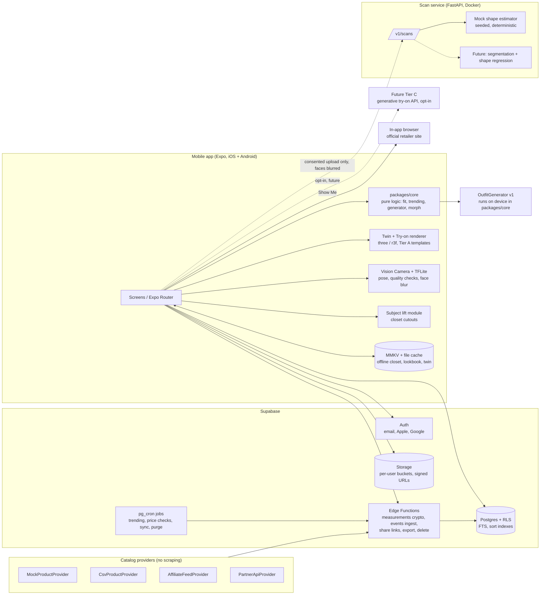

# FITTWIN — Planning Package (pre-Phase 1)

> Status: **awaiting approval**. No application code has been written.
> Date: 2026-09-28. Skills used for this document: `app-spec-writing`, `data-model-design` (loaded); risk register and legal triage done manually (see §7).

---

## 1. Tech stack recommendation

Your suggested stack is mostly right. Changes and clarifications are **bold**.

| Area | Choice | Why / change |
|---|---|---|
| App framework | React Native + Expo (current stable SDK), TypeScript strict, Expo Router | Keep. One codebase for iOS and Android. Expo handles builds, updates and most native setup. |
| Dev workflow | **Expo development builds (not Expo Go)** | Vision Camera, MMKV, frame processors and our own native modules can't run in Expo Go. A "dev build" is your own debug copy of the app with those native parts included. |
| Monorepo | **npm workspaces** (`apps/`, `packages/`, `services/`) | Expo supports monorepos out of the box. I chose npm over pnpm/yarn so you install one tool fewer. |
| 3D | `three` + `@react-three/fiber/native` + `expo-gl` | Keep, **with a 2-day spike at the start of Phase 2**. Fallback: `react-native-filament` (a native PBR renderer, faster, but harder for geometry generated at runtime like chains). The renderer sits behind `SceneRenderer`, so swapping it only touches one package. Go/no-go test: body + 6 garments + 3 accessories at ≥30 fps on a Pixel 6a-class phone. |
| Camera | **`react-native-vision-camera`** | Needed: frame processors run pose and quality checks on every frame in real time. `expo-camera` has no frame-processor API, so the live guidance in §3.2 would be impossible with it. |
| On-device pose / person detection | **One cross-platform TFLite model (MediaPipe BlazePose / MoveNet) via `react-native-fast-tflite` inside a frame processor** | Same model and thresholds on both platforms, so quality checks behave the same everywhere. Apple Vision / ML Kit would mean two code paths to keep in sync. |
| Face blur before upload | MediaPipe face detector (TFLite, same pipeline) + blur with `@shopify/react-native-skia` | Runs on the device. The pixels are changed before any upload is possible. |
| Closet background removal | **Custom Expo module**: iOS Vision foreground-instance mask (iOS 17+), Android ML Kit Subject Segmentation. Fallback: MediaPipe selfie/interactive segmenter or a manual crop tool | Best quality available for free on each OS. **Note:** the iOS API needs iOS 17, so on iOS 16 users get the fallback (see question Q4). |
| State | Zustand (client) + TanStack Query (server) | Keep. |
| Forms | React Hook Form + Zod | Keep. **Zod schemas live in `packages/core` and are shared by the client, Edge Functions and seed scripts.** |
| Storage | `expo-secure-store` (tokens), MMKV (cache), `expo-file-system` (images) | Keep. **Offline lookbook/closet: MMKV-persisted TanStack Query cache + a small mutation queue.** I recommend against a full sync engine (WatermelonDB/PowerSync) for v1: too much complexity for last-write-wins rules. |
| Lists | **`@shopify/flash-list`** | Product grids with no dropped frames. |
| Images | **`expo-image`** | Built-in disk cache and blurhash placeholders. |
| Animation | Reanimated + Gesture Handler | Keep. |
| i18n | i18next + `react-i18next`, `Intl` for numbers and currency | Keep. |
| Backend | Supabase (Auth, Postgres + RLS, Storage, Edge Functions, `pg_cron`) | Keep. It covers auth, database, files, cron and serverless in one free-tier account. |
| Sensitive columns | **Envelope encryption done inside Edge Functions** (per-user data key wrapped by a master key kept in Edge Function secrets; libsodium) | Supabase's old column-encryption feature (pgsodium TCE) is deprecated, so I won't build on it. See ADR in §2 / DECISIONS.md. |
| Scan service | Python 3.12 + FastAPI + Pydantic v2, Docker | Keep (3.12 instead of 3.11; both fine). The mock runs locally or on any container host. Hosting decided in Phase 5. |
| Jobs | `pg_cron` → Edge Functions (trending recompute, price checks, catalog sync, raw-frame purge) | No extra queue product for v1. |
| Tests | Jest (`jest-expo`) + React Native Testing Library; **Maestro** for E2E; pytest for the scan service | Maestro tests are simple YAML files and work with Expo dev builds. Detox is harder to set up and more fragile. |
| CI | GitHub Actions: typecheck, lint, unit tests, **gitleaks** secret scan, `npm audit`, pytest | EAS Build runs only when we ask for it (it has free-tier limits). |
| Crash reporting | Sentry, **off until you approve** | PII scrubbing is configured before we turn it on. |
| Weather | `WeatherService` interface, mock first | Options for later: Apple WeatherKit (included in Apple Developer membership, needs an attribution screen), or Open-Meteo (free only for non-commercial use). See Q10. |
| Currency | `CurrencyService`, mock rates first | Later: the ECB daily reference rates (free, updated once a day). |

### Things in the spec I'd change (rule 8, stated plainly)

1. **Gender vs. body template.** Right now one field does three jobs: identity, which section of the catalog to show, and which body mesh to use. I recommend three separate fields: `bodyTemplate` (masculine / feminine base mesh, required), `shopSections` (men / women / both, default taken from the template), and an optional gender field. Then "Prefer not to say" needs no special case, users who shop both sections are served properly, and the recommendation engine never has to guess identity. Skirts and dresses stay available on either template if the user shops that section.
2. **Age gate for the scan.** 16+ for the app is defensible. But full-body photos of 16–17 year olds are a real child-safety and legal exposure. I recommend **18+ for photo scan and photo upload**, with 16–17 year olds using the measurements-only twin (Q2).
3. **The v1 scan should be on-device only.** The spec treats server upload as optional. I'd go further: ship v1 with **no raw-frame upload at all**. The mock scan service contract still gets built and tested (Phase 5), but we don't turn on real server processing until a lawyer has reviewed BIPA/CUBI/GDPR. On-device, the scan gives quality-checked photos plus pose-derived proportion ratios that refine the measurement-driven twin. This largely removes the biggest legal risk at launch.
4. **Honesty about scan accuracy.** Single-phone photo-to-body methods typically miss circumferences by several centimetres. So measurements the user enters are **the source of truth for Fit Score**. Scan-derived values are offered as suggestions ("scan says X, you entered Y") and are never auto-applied.
5. **Trending events need consent too.** An anonymous counter still travels in a request tied to a logged-in session (JWT + IP). I recommend counting an event towards trending only when analytics consent is ON. Trending then relies on seeded/editorial data plus consenting users (cold start covered). The counter RPC rate-limits by user in memory but never stores the user id.
6. **Phase 4 is too big.** The try-on renderer, the fit engine, accessories and the Lookbook are each substantial. I split it into **4a (renderer + fit + composer)** and **4b (accessories on twin + Lookbook + Wear Today)**, each with its own tag.
7. **Where the code lives.** This repository is your GitHub profile repo. FITTWIN should get its own repository (e.g. `fittwin`). Until you decide (Q1), the plan lives in `fittwin/docs/`.

---

## 2. Repository / folder structure

```
fittwin/
├─ apps/
│  └─ mobile/                      # Expo app
│     ├─ app/                      # Expo Router routes (file = screen)
│     │  ├─ (auth)/                # sign-in, sign-up, reset
│     │  ├─ (onboarding)/          # intro, profile, style-quiz, consent, measurements
│     │  ├─ (tabs)/                # discover, twin, closet, outfits, profile
│     │  ├─ product/[id].tsx
│     │  ├─ scan/                  # checklist, capture, review
│     │  ├─ try-on/                # composer, accessory zoom, ring selector, chain editor
│     │  ├─ outfits/               # detail, wear-today, planner, style-me
│     │  ├─ closet/                # item detail, add-by-photo
│     │  └─ settings/              # privacy center, notifications, delete account, legal
│     ├─ src/
│     │  ├─ features/              # feature folders: auth, catalog, twin, tryon, closet, lookbook, generator, scan, planner, share
│     │  ├─ components/            # shared UI (Button, Chip, Sheet, ProductCard, SortBar, FilterSheet…)
│     │  ├─ theme/                 # tokens (color, space, radius, type, elevation, motion), light/dark
│     │  ├─ services/              # interface impls: supabase, providers, currency, weather, analytics, flags
│     │  ├─ stores/                # Zustand stores
│     │  ├─ i18n/                  # en.json, setup, RTL helpers
│     │  └─ lib/                   # errors, retry, haptics, permissions
│     ├─ modules/                  # local Expo native modules (subject-lift, face-blur helpers)
│     ├─ assets/                   # fonts, icons, base GLBs, template garment GLBs
│     ├─ e2e/                      # Maestro flows
│     └─ app.config.ts
├─ packages/
│  ├─ core/                        # PURE TS, no RN imports, ≥80% coverage
│  │  ├─ units/                    # cm↔in, kg↔lb, validation ranges & ratios
│  │  ├─ anthropometry/            # missing-measurement regression (documented coefficients)
│  │  ├─ morph/                    # measurements → morph weights (calibrated JSON)
│  │  ├─ fit/                      # clothing fit score, accessory fit
│  │  ├─ pricing/                  # effective price, tiers, formatting, currency conversion
│  │  ├─ sorting/                  # sort keys, cursor encode/decode
│  │  ├─ trending/                 # decay, normalization, cold start
│  │  ├─ recommend/                # rankProducts
│  │  ├─ outfit/                   # slots, validation, availability status, completeness, dedupe
│  │  ├─ generator/                # seeded constraint + scoring engine, "why this works"
│  │  ├─ wear/                     # wear counts, cost-per-wear, logs
│  │  ├─ consent/                  # consent gating rules
│  │  └─ schemas/                  # Zod schemas shared by client + Edge Functions
│  ├─ catalog/                     # ProductProvider interface + Mock/CSV/AffiliateFeed/PartnerApi providers, mock data generator
│  ├─ renderer/                    # TryOnRenderer + SceneRenderer interfaces, Tier A templates, anchors, PBR presets
│  └─ config/                      # shared eslint, tsconfig, prettier, jest presets
├─ supabase/
│  ├─ migrations/                  # timestamped SQL, each with a documented rollback
│  ├─ functions/                   # Edge Functions (Deno): measurements-crypto, events-ingest, trending-recompute, catalog-sync, price-check, share-link, export-data, delete-account
│  ├─ seed/                        # taxonomy, brands, mock products
│  └─ tests/                       # pgTAP RLS tests
├─ services/
│  └─ scan/                        # FastAPI: app/, tests/, openapi.yaml, Dockerfile
├─ tools/
│  ├─ blender/                     # base-mesh + morph + calibration scripts (MPFB2/MakeHuman CC0)
│  └─ glb-validate/                # GARMENT_ASSET_SPEC validator CLI
├─ docs/                           # ARCHITECTURE, DATA_MODEL, DECISIONS, PRIVACY, TESTING, SCREENS,
│                                  # GARMENT_ASSET_SPEC, THREAT_MODEL, ANALYTICS, SKILLS_USED, PLANNING
├─ .github/workflows/ci.yml
├─ .env.example
└─ package.json                    # npm workspaces root
```

**Rule:** `packages/core` can't import React Native, Supabase or anything that does I/O. That's what keeps fit score, trending and the generator pure and testable.

---

## 3. Architecture



Key flows:
- **Twin:** measurements → `core/morph` → morph weights → base GLB. Only the parameters are stored (encrypted); the GLB is rebuilt on the device from them.
- **Try-on:** product + chosen size → `core/fit` (score) and `renderer` (template + color/pattern + ease-scaled shell) → scene.
- **Generator v1** runs **entirely on device** (closet + cached catalog candidates). That's fast, works offline and keeps privacy simple. Shop candidates come from a server query with filters only (no body data sent).
- **Trending:** consented events → `events-ingest` Edge Function → `product_events_agg` (no user id) → nightly/hourly `trending-recompute` → `products.trending_score`.

---

## 4. Phase plan (refined)

Estimates are **my build effort in focused working days**, plus **your testing time**. Real calendar time depends on how quickly you can test and reply; budget roughly 1.5–2× the build effort.

| Phase | Scope (delta from spec) | Build effort | Complexity | Main unknowns |
|---|---|---|---|---|
| **1 Foundation** | As spec + CI with secret scan, feature-flag service, typed error model, `packages/core` skeleton with first TDD modules (units, pricing) | 4–6 days | Medium | Your machine setup; Apple/Google sign-in stays mocked until keys arrive |
| **2 Onboarding + Parametric Twin** | As spec + renderer spike (day 1–2), Blender pipeline for CC0 base meshes, calibration script, split gender/template/shop-section fields, consent v1 | 10–14 days | **High** | Base mesh quality; r3f performance on Android |
| **3 Catalog, Discovery, Sorting** | As spec. Full schema + RLS + pgTAP tests, 250 mock products, cursor pagination, trending fn + cron, Show Me, affiliate label | 9–12 days | Medium-High | Supabase full-text search tuning; currency-converted price sort (see note ¹) |
| **4a Try-on + Fit + Composer** | Tier A clothing templates, slots/anchors, fit engine (clothing + accessories), composer, undo/redo, export image | 12–16 days | **Very High** | Template garments that conform to morphing bodies (the hardest graphics task in the project) |
| **4b Accessories on twin + Lookbook** | Hats, glasses, rings, chains, earrings, watch, bracelet, belt, bag, scarf, zoom presets, Lookbook, Wear Today, wear log | 10–13 days | High | Readable small accessories at phone scale |
| **5 Guided Scan + Scan Service** | compliance check first; capture UI, TFLite quality checks, coverage ring, face blur, FastAPI mock + OpenAPI, reconciliation UI, delete flow | 10–14 days | High | Frame-processor performance on low-end Android; reliable angle estimation |
| **6 Closet + Style Me** | As spec | 11–14 days | High | Subject-lift quality; generator taste |
| **7 Extras** | As spec, all behind flags | 12–16 days | Medium-High | Push setup on both stores; weather provider choice |
| **8 Polish + Release** | As spec | 9–12 days | Medium | Store review; privacy labels; real-device testing |
| **9 Future** | Written plan only | 1–2 days | — | — |
| **Total** | | **~88–120 build days** | | |

¹ **Price sort across currencies:** exact server-side sort on a converted price means a computed column per user currency. The plan: store `effective_price_cents` + `currency`. Also store `effective_price_usd_cents`, refreshed when exchange rates change (daily). Sort and paginate on that, and display in the user's currency. With daily rates the order can drift slightly from the exact converted order. I'll document that as a known limit.

Per-phase acceptance criteria are those in spec §16, plus: (Phase 3) pagination stability test with duplicate prices; (Phase 4a) any mock product renders in <1.5 s after the asset is cached; (Phase 5) a scan delete test that checks DB rows, storage objects and scan-service state.

---

## 5. Data model review (skill: `data-model-design`)

Classification of the §13 tables:
- **User-owned (RLS `user_id = auth.uid()`):** profiles, body_twins, measurements, scan_jobs, closet_items, outfits, outfit_items, outfit_wear_log, outfit_plans, outfit_likes, generation_requests, wishlist, notifications, share_links, consents.
- **Global reference (read-only for clients; writes by service role):** brands, products, product_variants, size_charts, styles, product_styles, categories, price_history, exchange_rates, product_events_agg.
- **Append-only:** consents (a new row per version, never updated), outfit_wear_log, audit_log, price_history.
- **Public-by-token:** share_links / share_votes, accessed only through an Edge Function that validates a hashed token. There is never a direct table grant to `anon`.

Decisions to record in DECISIONS.md:
1. **Sensitive fields:** `measurements.values`, `body_twins.parameters`, `profiles.date_of_birth` are stored as ciphertext (`bytea`) plus `key_version`. Encryption and decryption happen only inside the `measurements-crypto` Edge Function, with per-user data keys. Only an `age_verified_at` + `is_adult` flag is kept in plain form, not the date of birth itself. Nothing sorts or filters on these fields server-side, and fit scoring runs on the device.
2. **Money:** integer minor units + ISO currency, never floats.
3. **Optimistic locking:** `updated_at` versioning on outfits, closet_items, outfit_plans. The client sends it back and a stale write gets `409` → "this outfit was changed on another device" prompt. For offline sync the spec asks for last-write-wins per field. I'll honor that for fields like name, notes and tags. For the items list inside an outfit, the whole list is replaced as one unit (field-level merge of items can produce outfits with invalid slots).
4. **Atomic writes:** saving an outfit (outfit + items) goes through one Postgres RPC in a single transaction. "Mark as worn" (outfit wearCount + closet item wear counts + wear log row) is one RPC and idempotent with a client-generated key.
5. **Scan data:** `scan_jobs` never stores image references after completion. Raw frames live in a private bucket with a lifecycle purge (target: minutes; hard cap: 24h via cron sweep).
6. **Account deletion** is one Edge Function: storage objects → rows (cascade) → scan-service delete → auth user. It is idempotent and resumable, and it writes an audit entry with no personal data.

---

## 6. Candid assessment of the hard parts

| Hard part | Reality | What I recommend |
|---|---|---|
| **Photo-to-3D accuracy** | Consumer phone photos with no depth sensor and no calibration object give rough proportions, not tailor accuracy. Commercial apps that claim ~1 cm use proprietary models trained on large scanned datasets. | Treat the scan as a *proportion refiner* and a quality-assured photo set. The user's measurements drive fit. Never claim accuracy numbers in the store listing. A real ML model is Phase 9 and needs either a licensed body model or a vendor. |
| **Garment realism** | Template garments recolored from the product image will look like "a grey hoodie shaped like a hoodie", not the actual product. | Lean into a clean, stylized mannequin look (think fashion-sketch-meets-3D) instead of chasing photorealism. Label results "approximate visualization". Show the real product photo side-by-side on the Try-on screen. |
| **Small accessories** | A ring is ~2 mm thick on a 1.7 m body. At full-body zoom it's invisible. Chains need to follow the neck and chest. Glasses need a head shape, but we have no face. | Zoom presets are mandatory, not optional. Rings and earrings are only really visible in zoom views. Chains are procedural tube geometry along a spline fitted to neck/chest anchor points. Glasses sit on a simplified mannequin head with an eye-line socket. Fit for glasses is always labeled "low confidence". |
| **Trending cold start** | With few users and consent-gated events, real signals will be close to zero for months. | Seeded editorial boosts + recency + per-category normalization. The "Trending" badge only shows when a score clears a minimum-signal threshold, so we never show a meaningless badge. |
| **Outfit generator quality** | Rule-based engines produce "valid but boring" outfits, and color harmony from product swatches is noisy. | Invest in the scoring weights and a hand-labeled test set (~50 outfits you rate). Run determinism tests plus a "taste" regression suite. Use the local thumbs up/down to personalize. |
| **Biometric-privacy exposure** | BIPA allows private lawsuits with statutory damages per violation. Whether full-body images or derived body shape count as "biometric identifiers" is legally unsettled. Face geometry clearly does. | On-device-only v1 (see §1 change 3), face blur/crop enforced in code before any upload path exists, 18+ for scan, granular consent logged with its version, a lawyer review before any server upload is enabled. |
| **Base-mesh licensing** | SMPL/SMPL-X weights are research-only by default. | Use MakeHuman/MPFB2 output (CC0) authored via Blender scripts in `tools/blender`. Record the source and license of every asset in `assets/LICENSES.md`. |
| **Real product data** | Affiliate feeds need approved publisher accounts, and approval usually requires a live app or site. Feed image licenses vary by network and by brand. | Mock catalog through Phase 8. Apply to 1–2 networks during Phase 7 so approval arrives around launch. |

---

## 7. Risk register (structured manually; `operations:risk-assessment` not installed)

L = likelihood, I = impact (1–5). Owner: **Y** = you, **C** = me (Claude), **L** = a lawyer.

| # | Risk | Type | L | I | Mitigation | Owner |
|---|---|---|---|---|---|---|
| 1 | Biometric-law exposure (BIPA/CUBI/GDPR Art. 9) from body images or derived shape | Legal | 3 | 5 | On-device-only v1, no face data, 18+ scan, versioned consent, 24h hard purge, lawyer review before enabling upload | Y + L |
| 2 | Twin looks unconvincing / "uncanny", so users don't trust try-on | Product | 4 | 4 | Stylized mannequin art direction, early design critique, show product photo alongside, test with 5–10 users after Phase 4 | C + Y |
| 3 | 3D performance on mid/low-end Android | Technical | 3 | 4 | Phase 2 renderer spike with a go/no-go, triangle/texture budgets enforced by the GLB validator, quality tiers | C |
| 4 | Template garments don't conform to morphed bodies (clipping) | Technical | 4 | 3 | Garments share the body's morph targets (same names and topology influences), offset shells, clipping visual test per template × body extreme | C |
| 5 | No real catalog data at launch (affiliate approval delay) | Business | 4 | 4 | Apply to networks early; CSV import for manual partner catalogs; launch as a "closet + lookbook" app with shopping as a bonus if needed | Y |
| 6 | App Store / Play rejection (body imagery, account deletion, SIWA, misleading claims, 16–17 users) | Compliance | 3 | 4 | Store compliance checklist from Phase 1, honest permission strings, in-app deletion, no accuracy claims, 17+ age rating on iOS if required by content | C + Y |
| 7 | Trademark / image-rights complaints over brand names or imagery | Legal | 2 | 4 | Factual brand use only, placeholder imagery, disclaimer footer, licensed feed images only | Y + L |
| 8 | Data breach of measurements / closet photos (IDOR, RLS gap, leaked share link) | Security | 2 | 5 | RLS on every table with pgTAP tests, encrypted columns, hashed expiring share tokens, security review each phase, threat model | C |
| 9 | Scope creep and solo-builder fatigue (~100 build days) | Delivery | 4 | 3 | Strict phase gates, feature flags, Phase 7 items can be cut or reordered without breaking anything | Y + C |
| 10 | FTC affiliate disclosure / consumer-protection issues (price-drop alerts, "trending" claims) | Legal | 2 | 3 | Visible "Affiliate link" labels, disclosure page, trending badge only with real signal, no fake urgency | C + L |

**Needs a real lawyer (`legal:legal-risk-assessment` not installed, so this is my own triage and not legal advice):** #1 (biometric scope and consent wording), privacy policy and terms, the 16–17 decision, #7 (brand name use and any partner agreements), affiliate network contracts, and the MakeHuman/CC0 asset review if you raise money.

---

## 8. Skills report

**Found and loaded for planning:** `app-spec-writing`, `data-model-design`.

**Available and will be used when their phase comes:** `feature-spec-writing` (start of every phase), `doc-coauthoring` (docs, privacy/terms drafts), `learn` (your "what is X?" questions), `apple-design` (Phases 2, 4, 6, 8), `canvas-design` (store graphics), `pptx` (only if asked), `skill-creator` (only if asked). Built-in stand-ins: Claude Code's `/security-review` covers `dev-essentials:security-review`, and `/code-review` + `/simplify` support the diff-review step of the verification loop.

**Missing, but installable from your plugin catalog** (claude.ai → Settings → Plugins/Capabilities, or ask me to show the install card):
| Plugin | Gives you |
|---|---|
| **Design** (Anthropic, Knowledge Work) | design:design-system, ux-copy, accessibility-review, design-critique, design-handoff, user-research |
| **Legal** (Anthropic) | legal:compliance-check, legal:legal-risk-assessment |
| **Operations** (Anthropic) | operations:risk-assessment |
| **Product Management** (Anthropic) | product-management:write-spec |
| **Marketing** (Anthropic) | marketing:draft-content, marketing:campaign-plan |
| **Customer Support** (Anthropic) | customer-support:kb-article |
| **frontend-design** (Anthropic, official directory) | frontend-design |

Most useful to install now: **Design** (needed from Phase 1) and **Legal** (needed before Phase 5). The rest can wait until Phase 8.

**Missing and not found in the catalog:** the `dev-essentials:*` family (tdd-workflow, verification-loop, api-design, backend-patterns, postgres-patterns, database-migrations, frontend-patterns), `modern-web-guidance`, figma skills. I'll follow their practices by hand: tests first for `packages/core`, a scripted `npm run verify` (build + typecheck + lint + test + gitleaks + diff review), OpenAPI-first API design, pgTAP-tested RLS, and migrations with rollbacks. I'll log each use in `docs/SKILLS_USED.md` as "manual — skill not installed".

---

## 9. Open questions (numbered; most are one-word answers)

1. **Repo:** create a new GitHub repo `fittwin` for the app (recommended), or keep it inside this profile repo?
2. **Age:** 16+ for the app but **18+ for photo scan/upload** (recommended), or 16+ for everything?
3. **Gender field:** accept the split into body template + shop sections + optional gender (recommended)?
4. **iOS minimum:** stay at iOS 16 (closet cutout falls back to a lower-quality method on 16), or raise to iOS 17?
5. **v1 scan:** on-device only at launch, with server upload built but switched off (recommended)?
6. **Your computer:** Mac or Windows? (Only a Mac can run the iOS Simulator.)
7. **Your phones:** which iPhone and which Android phone can you test on?
8. **Launch markets:** US only, or also EU/UK? (This decides how much GDPR work comes first and which currencies to default to.)
9. **Default currency and units:** USD + imperial, or something else?
10. **Weather later:** Apple WeatherKit (free with the Apple Developer account) or a paid provider? (Only needed in Phase 7.)
11. **Accent color / brand feel:** any preference, or should I propose 2–3 directions in Phase 1?
12. **Mock brand names:** the spec lists real brands (Uniqlo, SHEIN, Polo Ralph Lauren, OVO). Using real names with fake products and prices in a demo is a trademark gray area. Use **fictional brand names** in mock data (recommended), or real names clearly marked as placeholders?
13. **Budget:** OK with $0/month through Phase 7 (all free tiers), then Apple $99/yr + Google $25 one-time before release?
14. **Sentry:** fine to plan for it in Phase 8 (free tier, PII scrubbed), or no crash reporting at all?
15. **Time:** roughly how many hours a week can you test? This decides whether we slow down or reorder Phase 7.

---

## 10. What to install on your computer

(Detailed click-by-click steps are in the reply message; summary here.)

- **Everyone:** Git, Node.js LTS (via the official installer), VS Code, Docker Desktop (for the local Supabase and the scan service). The Expo Go app is **not** needed (we use dev builds). The **Maestro** CLI gets installed later, in Phase 1.
- **Mac:** Xcode (App Store) + Command Line Tools, Homebrew, Watchman and CocoaPods (via Homebrew), Android Studio (for the Android Emulator).
- **Windows:** Android Studio (for the emulator). iOS testing uses **EAS cloud builds** installed on your iPhone, which needs the Apple Developer account.
- **Later (Phase 2):** Blender (free), only if you want to look at the body meshes yourself. I can script it without you.

## 11. Accounts

| Account | Cost | When |
|---|---|---|
| GitHub | free | now (you have it) |
| Expo (expo.dev) | free tier | Phase 1 |
| Supabase | free tier | Phase 1 (local-only is possible until Phase 3) |
| Apple Developer Program | $99/year | Needed for Sign in with Apple and for cloud (EAS) builds on a real iPhone. With a Mac + Xcode, a free Apple ID can put dev builds on your own iPhone (they expire after 7 days). Ideally by Phase 2 |
| Google Cloud project (for Google Sign-In OAuth client) | free | Phase 1 is mocked; real keys by Phase 3 |
| Google Play Console | $25 once | Phase 8 (internal testing track) |
| Sentry | free tier | Phase 8, only with your approval |
| Affiliate networks (Awin, Rakuten, Impact, CJ) | free to apply | Apply during Phase 7 |
| Weather provider | see Q10 | Phase 7 |
| A lawyer (privacy/biometrics) | paid | Before enabling server scan upload and before release |
